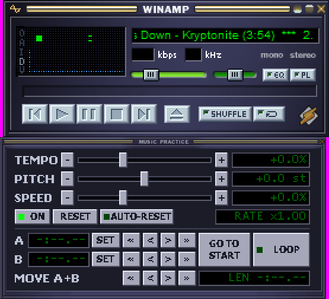

# Music Practice for Winamp

A Winamp 5.x DSP plug-in that replaces two old plug-ins in one panel:

- **PaceMaker**: change tempo, pitch and speed while music plays.
- **Loop Master**: A-B looping, with buttons to nudge the loop points.

The panel is a real Winamp window. It uses the same frame as the equalizer and Media Library, so it takes on your classic skin, snaps and docks to Winamp's other windows, and follows double-size mode. It has no nag screen and no network access.



## Install

1. Close Winamp.
2. Run `MusicPractice-Setup.exe` (it asks for admin rights because Winamp lives in Program Files).
3. Start Winamp. Show or hide the panel from Winamp's main menu: click the lightning-bolt logo or right-click the title bar, then choose **Music Practice**.

The installer can also make Music Practice the active DSP plug-in (replacing PaceMaker) and switch Loop Master off by moving it to `Plugins\Disabled`. Run the installer again to update or uninstall. Uninstalling puts PaceMaker and Loop Master back.

Manual install: copy `dsp_musicpractice.dll` to `Winamp\Plugins`, then choose it under Preferences (Ctrl+P) > Plug-ins > DSP/Effect.

## Using it

| Control | What it does |
|---|---|
| TEMPO | Speed up or slow down without changing pitch (-50% to +100%). |
| PITCH | Shift pitch without changing tempo (±12 semitones). |
| SPEED | Change both together, like a turntable (-50% to +100%). |
| `-` / `+` | Step 1% or 1 semitone. Hold to repeat. |
| Mouse wheel on a slider | Step 1%. Hold Shift for 0.1. |
| Double-click / right-click a slider | Reset it to 0. |
| ON | Switch processing on or off without losing your slider settings. Off shows BYPASSED. |
| RESET | Reset all three sliders. |
| AUTO-RESET | Reset the sliders whenever a new song starts. |
| A / B `SET` | Set the loop start or end at the current position. |
| `«` `<` `>` `»` | Nudge the point by 1 s or 40 ms. |
| GO TO START | Jump to A, the start of the loop. |
| MOVE A+B `«` `»` | Shift the whole loop by its own length. `<` `>` shift it by 40 ms. |
| LOOP | Turn looping on or off (needs A and B set). |

Loop points clear when the song changes. Settings and the panel position are saved in `%APPDATA%\Winamp\Plugins\musicpractice.ini`.

### Notes

- Winamp runs only one DSP plug-in at a time, so Music Practice takes PaceMaker's place.
- Winamp limits a DSP to 0.5x to 2x of real time. Tempo and speed together are kept inside that range.
- Winamp's own position display assumes 1:1 playback. Music Practice works out the position you're actually hearing when audio is stretched, and its loop points use that, so loops stay tight at slow tempos.
- Built and tested with the classic skin. Modern skins should host the panel, but they haven't been tested.

## Building

Requirements: Visual Studio 2019 or 2022 with the "Desktop development with C++" workload (x86 tools).

```
git clone --recursive <this repo>
build.cmd
```

Output goes to `build\`: `dsp_musicpractice.dll` and `MusicPractice-Setup.exe` (the installer has the DLL embedded). If you cloned without `--recursive`, run `git submodule update --init` first.

Debugging: set the environment variable `MUSICPRACTICE_DEBUG=1` before starting Winamp, and the plug-in logs to `%TEMP%\musicpractice_debug.log`.

## Layout

```
src/winamp_min.h     Minimal Winamp SDK declarations (DSP, In/Out module, IPC, embedded windows)
src/plugin.cpp       DSP entry points
src/dsp.cpp          SoundTouch processing, output pacing, position tracking
src/ui.cpp           Docked panel: drawing, input, looping, Winamp menu item, settings
installer/           MusicPractice-Setup.exe
third_party/soundtouch  SoundTouch 2.3.3 (git submodule)
```

## License

GPL-3.0-or-later (see `LICENSE`). You can use, change and share Music Practice, and anything built from it must also be released under the GPL with its source code.

Music Practice includes [SoundTouch](https://codeberg.org/soundtouch/soundtouch), which is licensed separately under the LGPL-2.1 (see `third_party/soundtouch/COPYING.TXT`). The LGPL allows SoundTouch to be combined into a GPL-3.0 program.

Music Practice is not affiliated with Winamp or with the PaceMaker or Loop Master authors.
